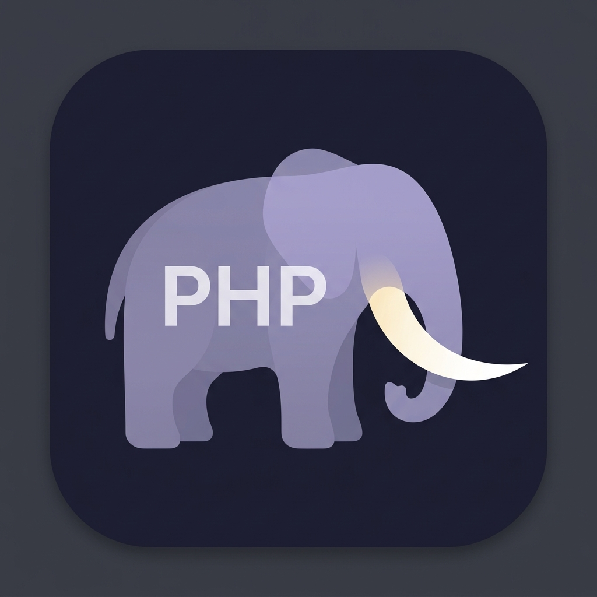

  

<h1 align="center">Tusk PHP</h1>

  <strong>A fast, framework-aware PHP language server.</strong> 
  One small Go binary. Laravel and Symfony container intelligence. MIT licensed.

  
  
  
  
  

  
  
  

---

## Why Tusk PHP

|   |   |
|---|---|
| ⚡ **Ready in under a third of a second** | On the 23,800-file Filament demo app, Tusk PHP answers its first cross-file request in 280 ms and peaks at 499 MB. Intelephense needs 2.0 s and 984 MB. [See the benchmarks](#benchmarks). |
| 🧠 **Understands your container** | `app('request')->`, `$container->get(...)`, `#[Autowire]` and interface bindings resolve to the concrete class, for completion, hover and go-to-definition. |
| 🌍 **Works where you work** | Local projects, **Remote SSH** in VS Code and Zed, **vscode.dev** (in the browser, through WebAssembly), and any editor that speaks LSP. |
| 🤖 **Talks to your AI agent** | `tusk-php mcp` gives Claude Code, Codex and Cursor the same index your editor uses: symbols, diagnostics, routes, models, test coverage and your database schema. |

## Get it

| Editor | How |
|---|---|
| **VS Code / VSCodium** | Install from the [VS Code Marketplace](https://marketplace.visualstudio.com/items?itemName=open-southeners.tusk-php) or [Open VSX](https://open-vsx.org/extension/open-southeners/tusk-php). The server is bundled, so there's nothing else to set up. |
| **Zed** | *Coming soon to Zed's extension registry.* Until then, install [Tusk-PHP/zed](https://github.com/Tusk-PHP/zed) as a dev extension. |
| **Neovim and others** | Download a binary from [Releases](https://github.com/Tusk-PHP/lsp/releases/latest) (Linux, macOS, Windows · amd64/arm64) and run `tusk-php --transport stdio`. |
| **AI agents** | `claude mcp add tusk-php -- tusk-php mcp --root "$(pwd)"`. [More agents](docs/ai-agents.md). |
| **CI and the terminal** | `tusk-php check` reports the same diagnostics as your editor, with a baseline so CI fails only on new ones. [Command line](docs/command-line.md). |

Setup for each editor is in [docs/editors.md](docs/editors.md), every setting is in [docs/configuration.md](docs/configuration.md), and every diagnostic, with how to turn it off, is in [docs/diagnostics.md](docs/diagnostics.md).

## Features

**Code intelligence**
- Completion that follows method chains through return types and docblocks, so `User::query()->with('posts')->where()->` offers `Builder` methods. Picking a class adds its `use` line.
- Hover with signatures, docblocks, inheritance and container bindings, plus php.net links for built-ins.
- Go to definition, declaration (the interface or parent method a method implements), type definition and implementation. Type hierarchy: the parents, interfaces and traits of a class, and the classes below it. Find references, workspace symbols, highlights, folding, signature help. Clickable `require` and `include` paths, Laravel path helpers such as `base_path('routes/web.php')`, and links in comments.
- Inlay hints for inferred variable types, `foreach` types, closure and method return types, and parameter names.

**Smart renames and refactoring**
- Rename variables within their scope, and classes, methods and properties across the whole workspace.
- **Move to namespace** moves a class, updates every reference and moves the file to match your PSR-4 autoload.
- Copy namespace or a reference to the symbol under the cursor (FQN, `Class::method()` or the full signature).
- Organize imports, remove unused ones and import unknown classes.
- Generate constructors, getters and setters. Implement missing methods. Extract or inline a variable.

**Diagnostics**
- Built-in checks for unknown classes, functions and members, undefined and unused variables, argument count, unused imports and private members, unreachable code, redundant types, deprecated functions, and abstract methods in concrete classes.
- Fast checks run as you type; heavier ones run on save. Every rule can be turned off or given its own severity.
- PHPStan and Laravel Pint results on save, when they're installed in your project.

**Test coverage**
- Hover shows how much of a method your tests reach, with its CRAP score, from the Clover report PHPUnit or Pest last wrote. Works with reports from Docker and Sail. [Setup](docs/configuration.md#test-coverage).

**Laravel**
- Service container bindings from your providers, plus 25+ core framework bindings.
- `config()` keys with value preview, routes, views and translations, all with completion and go-to-definition.
- Eloquent query chains, relations, casts and scopes. Unknown columns and relations are flagged in query builders.

**Symfony**
- Services from `services.yaml`, PHP config and autowiring, including `#[Autowire]` with `service:`, `param:` and `env:`.
- Routes from attributes and `config/routes.*`, console commands, and translation keys across YAML, PHP and XLIFF.

## PHP support

Tusk PHP indexes PHP 7.4 through 8.6. It picks the version from your Composer platform, `.tusk-php.json` or your local `php`, and defaults to 8.6.

| Version | Understood |
|---|---|
| **7.4** | typed properties, arrow functions, numeric separators, `??=`, array spread |
| **8.0** | union types, named arguments, `match`, `?->`, `static` / `mixed`, constructor promotion, attributes, `throw` expressions |
| **8.1** | intersection types, first-class callables, `never`, fibers, enums and their methods, `readonly` properties, `new` in initializers |
| **8.2** | `readonly` classes, `true` / `false` / `null` types, DNF types, constants in traits |
| **8.3** | `json_validate()`, typed class constants, `#[\Override]`, dynamic constant fetch |
| **8.4** | property hooks, asymmetric visibility, `new` without parentheses, `#[\Deprecated]`, `array_find()` and friends, lazy objects |
| **8.5** | pipe operator `\|>`, `#[\NoDiscard]`, `clone` with |
| **8.6** | partial function application (`f(?, 1)`, `f('x', ...)`), parameter doc comments, `readonly` property defaults, `#[\Override]` on constants and enum cases, `clamp()`, `SortDirection`, `Time\Duration`, stream errors, the polling API and the 8.6 deprecations |

Every entry is checked through the running server by `internal/lsp/php_versions_test.go`, so it means completion, hover, go-to-definition and diagnostics see the feature, not just that it parses.

PHPDoc generics are read the way [PHPStan](https://phpstan.org/blog/generics-in-php-using-phpdocs) defines them: `@template` on classes, methods and functions (bound from arguments, `class-string<T>`, constructors and closures, with bounds and defaults), `@extends` / `@implements` / `@use` through every level, `list<T>`, `iterable<K, V>`, generators, array and object shapes, `key-of` / `value-of`, callable signatures, conditional return types decided by the arguments, generic `@mixin`, and narrowing with `@phpstan-assert`, `@param-out` and `@phpstan-self-out`. `@phpstan-` and `@psalm-` tags win over plain ones, and `@phpstan-type` / `@psalm-type` aliases resolve. Hover, completion and diagnostics all see the same types; `internal/lsp/generics_test.go` checks each of these through the running server.

## Benchmarks

Every server gets the same LSP requests at the same cursor positions in the same workspaces, over stdio, with a cold cache and one server at a time. Tusk PHP 0.17.0, Intelephense 1.18.5, Phpactor 2026.11.22.0, php-lsp 0.33.0 and PHPantom 1.1.0, on Apple silicon.

The workspaces are the reference apps for 1.0.0, one real project per framework, each with its full `vendor/`, plus two small fixtures:

- **Filament demo** (Laravel, Livewire, Blade): the [Filament demo app](https://github.com/filamentphp/demo), Filament 5 on Laravel 13.
- **Sylius** (Symfony, Doctrine, API Platform): [Sylius-Standard](https://github.com/Sylius/Sylius-Standard) 2.3.1.
- **WooCommerce** (WordPress): WooCommerce 11.3.1 on WordPress 7.1.5, laid out as a site.
- **Mage-OS** (Magento 2): [Mage-OS](https://mage-os.org) 4.0.0 with the Luma sample data.

**Time to ready, and peak memory**

| Workspace | Tusk PHP | Intelephense | Phpactor | php-lsp | PHPantom |
|---|---|---|---|---|---|
| Filament demo (23.8k files) | **280 ms · 499 MB** | 1967 ms · 984 MB | 3757 ms · 1330 MB | 314 ms · 951 MB | 902 ms · 595 MB |
| Sylius (29.6k files) | 1425 ms · 613 MB | over 5 min · 1199 MB | 49.8 s · 997 MB | 2672 ms · 1106 MB | **1144 ms · 364 MB** |
| WooCommerce (5.2k files) | 648 ms · **205 MB** | over 5 min · 1200 MB | 10.4 s · 875 MB | **508 ms** · 826 MB | 609 ms · 612 MB |
| Mage-OS (55k files) | 3281 ms · 1226 MB | over 5 min · 1260 MB | 89.0 s · 1281 MB | 5363 ms · 1574 MB | **1988 ms · 483 MB** |
| Symfony fixture (1.1k files) | **42 ms · 45 MB** | 704 ms · 356 MB | 2341 ms · 508 MB | 285 ms · 138 MB | 322 ms · 67 MB |
| Small project (6 files) | **45 ms · 28 MB** | 190 ms · 292 MB | 2141 ms · 554 MB | 299 ms · 97 MB | 105 ms · 39 MB |

Ready is the first correct answer to the workspace's probe. On Sylius, WooCommerce and Mage-OS the probe is a workspace-symbol search that only a finished index answers, so it measures a full index; elsewhere it is a cross-file go-to-definition, which a server can answer before indexing ends. Intelephense's index didn't answer the probe within the five-minute limit on the three larger apps.

**Correct answers** (completion, definition, hover, references, signature help, symbols and diagnostics)

| Workspace | Tusk PHP | Intelephense | Phpactor | php-lsp | PHPantom |
|---|---|---|---|---|---|
| Filament demo | 27/33 | 14/33 | 20/33 | 23/33 | **28/33** |
| Sylius | 41/56 | 43/53 | 36/56 | 43/56 | **45/56** |
| WooCommerce | 43/56 | 44/54 | 36/56 | 45/56 | **49/56** |
| Mage-OS | **41/54** | 36/51 | 36/54 | 39/54 | 37/54 |
| Symfony fixture | 11/11 | 11/11 | 11/11 | 11/11 | 11/11 |
| Small project | 6/6 | 6/6 | 5/6 | 6/6 | 6/6 |

Intelephense runs without a licence, so the cases that need its paid features are left out of its count.

On the four reference apps Tusk PHP gets 152 of 199 right, PHPantom 159, php-lsp 150, Intelephense 137 of 191 and Phpactor 128. Tusk PHP is the only server that resolves Magento's generated factories and proxies and `ObjectManager::get()`, which puts it first on Mage-OS. Its misses on the other apps are mostly plain PHP that the other servers already answer: the types of `??`, `match` and destructured variables, narrowing after `if ($x)` or an early return, constructor and attribute parameters in signature help, and `define()` constants. These are planned for [0.19.0](https://github.com/Tusk-PHP/lsp/milestone/10), on the way to [1.0.0](https://github.com/Tusk-PHP/lsp/milestone/9). On readiness it is first on the Filament demo and the fixtures; PHPantom indexes Sylius and Mage-OS faster with less memory, and php-lsp is ready first on WooCommerce. Its interactive answers (completion, hover, definition, signature help) take under 2 ms at p95 in every workspace. No server yet answers Blade components or a widget's view on the Filament demo, or Symfony services fetched by id from the container.

Tusk PHP's PHPStan and Pint integrations are turned off for these runs, since no other server starts external tools. Run `make reference-apps && make bench-install && make bench` to reproduce the numbers; [bench/README.md](bench/README.md) explains the method and how answers are graded.

## Contributing

See [CONTRIBUTING.md](CONTRIBUTING.md) for development setup and guidelines.

## License

[MIT](LICENSE)
