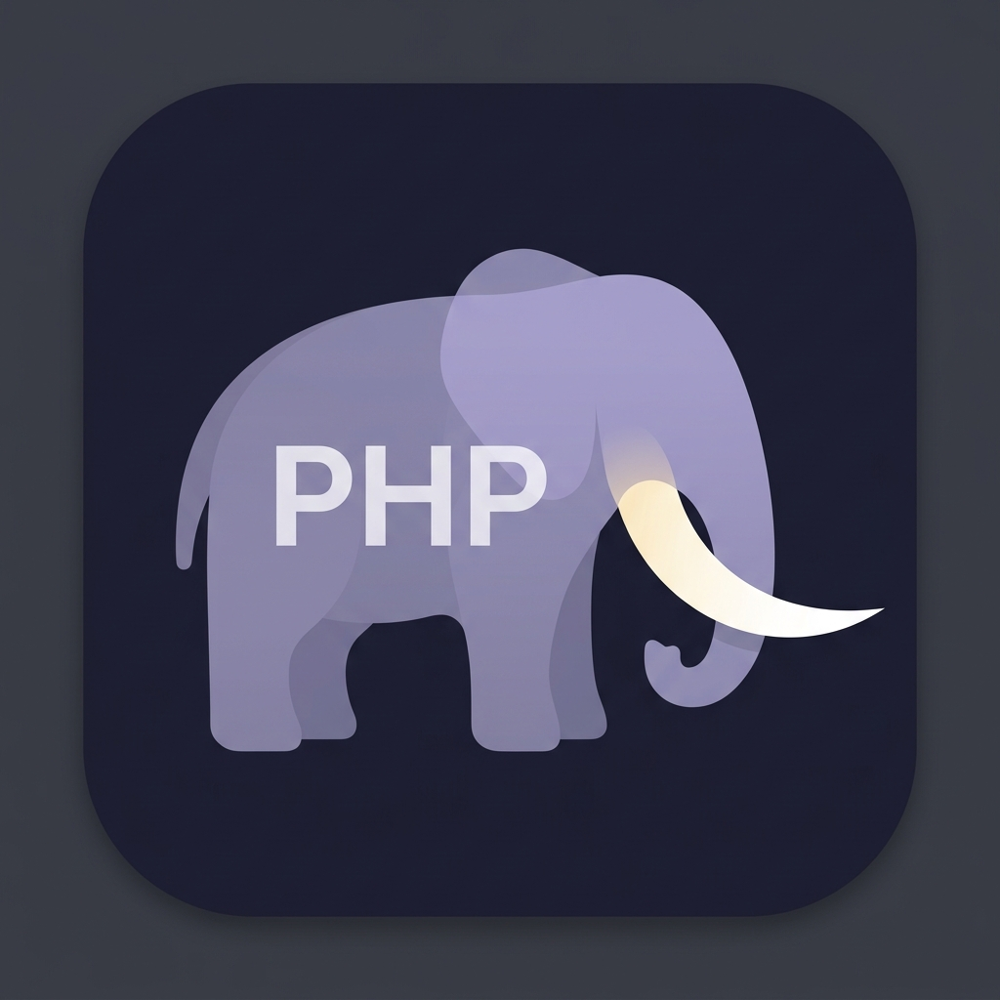

  

<h1 align="center">Tusk PHP</h1>

  <strong>A fast, framework-aware PHP language server.</strong> 
  One small Go binary. Laravel and Symfony container intelligence. MIT licensed.

  
  
  
  
  

  
  
  

---

## Why Tusk PHP

|   |   |
|---|---|
| ⚡ **Ready in under a third of a second** | On a 9,700-file Laravel app, Tusk PHP answers its first cross-file request in 283 ms using 162 MB. Intelephense needs 2.2 s and 686 MB. [See the benchmarks](#benchmarks). |
| 🧠 **Understands your container** | `app('request')->`, `$container->get(...)`, `#[Autowire]` and interface bindings resolve to the concrete class, for completion, hover and go-to-definition. |
| 🌍 **Works where you work** | Local projects, **Remote SSH** in VS Code and Zed, and any editor that speaks LSP. **vscode.dev** (in the browser, through WebAssembly) is coming soon. |
| 🤖 **Talks to your AI agent** | `tusk-php mcp` gives Claude Code, Codex and Cursor the same index your editor uses: symbols, diagnostics, routes, models, test coverage and your database schema. |

## Get it

| Editor | How |
|---|---|
| **VS Code / VSCodium** | Install from the [VS Code Marketplace](https://marketplace.visualstudio.com/items?itemName=open-southeners.tusk-php) or [Open VSX](https://open-vsx.org/extension/open-southeners/tusk-php). The server is bundled, so there's nothing else to set up. |
| **Zed** | *Coming soon to Zed's extension registry.* Until then, install [Tusk-PHP/zed](https://github.com/Tusk-PHP/zed) as a dev extension. |
| **Neovim and others** | Download a binary from [Releases](https://github.com/Tusk-PHP/lsp/releases/latest) (Linux, macOS, Windows · amd64/arm64) and run `tusk-php --transport stdio`. |
| **AI agents** | `claude mcp add tusk-php -- tusk-php mcp --root "$(pwd)"`. [More agents](docs/ai-agents.md). |

Setup for each editor is in [docs/editors.md](docs/editors.md), and every setting is in [docs/configuration.md](docs/configuration.md).

## Features

**Code intelligence**
- Completion that follows method chains through return types and docblocks, so `User::query()->with('posts')->where()->` offers `Builder` methods. Picking a class adds its `use` line.
- Hover with signatures, docblocks, inheritance and container bindings, plus php.net links for built-ins.
- Go to definition, type definition and implementation. Find references, workspace symbols, highlights, folding, signature help.
- Inlay hints for inferred variable types, `foreach` types, closure and method return types, and parameter names.

**Smart renames and refactoring**
- Rename variables within their scope, and classes, methods and properties across the whole workspace.
- **Move to namespace** moves a class, updates every reference and moves the file to match your PSR-4 autoload.
- Copy namespace or a reference to the symbol under the cursor (FQN, `Class::method()` or the full signature).
- Organize imports, remove unused ones and import unknown classes.
- Generate constructors, getters and setters. Implement missing methods. Extract or inline a variable.

**Diagnostics**
- Built-in checks for unknown classes, functions and members, undefined and unused variables, argument count, unused imports and private members, unreachable code, redundant types, deprecated functions, and abstract methods in concrete classes.
- Fast checks run as you type; heavier ones run on save. Every rule can be turned off or given its own severity.
- PHPStan and Laravel Pint results on save, when they're installed in your project.

**Test coverage**
- Hover shows how much of a method your tests reach, with its CRAP score, from the Clover report PHPUnit or Pest last wrote. Works with reports from Docker and Sail. [Setup](docs/configuration.md#test-coverage).

**Laravel**
- Service container bindings from your providers, plus 25+ core framework bindings.
- `config()` keys with value preview, routes, views and translations, all with completion and go-to-definition.
- Eloquent query chains, relations, casts and scopes. Unknown columns and relations are flagged in query builders.

**Symfony**
- Services from `services.yaml`, PHP config and autowiring, including `#[Autowire]` with `service:`, `param:` and `env:`.
- Routes from attributes and `config/routes.*`, console commands, and translation keys across YAML, PHP and XLIFF.

## PHP support

Tusk PHP indexes PHP 7.4 through 8.5. It picks the version from your Composer platform, `.tusk-php.json` or your local `php`, and defaults to 8.5.

| Version | Understood | Partly understood | Not yet |
|---|---|---|---|
| **7.4** | typed properties, arrow functions, numeric separators | | `??=`, array spread |
| **8.0** | union types, named arguments, `match`, `?->`, `static` / `mixed` | constructor promotion, attributes | `throw` expressions |
| **8.1** | intersection types, first-class callables, `never`, fibers | enums (cases only, not methods), `readonly` properties | `new` in initializers |
| **8.2** | `readonly` classes, `true` / `false` / `null` types | | DNF types, constants in traits |
| **8.3** | `json_validate()` | `#[\Override]`, dynamic constant fetch | typed class constants |
| **8.4** | property hooks, asymmetric visibility | `new` without parentheses, `#[\Deprecated]`, `array_find()` and friends | lazy objects |
| **8.5** | | pipe operator `\|>`, `#[\NoDiscard]` | `clone` with |

"Partly understood" means the syntax parses cleanly but not every feature sees it yet: for example, enum methods don't show in completion, and types don't flow through `|>`.

PHPDoc is well covered: `@template` generics, `@phpstan-type` / `@psalm-type` aliases, array shapes and `Collection<int, User>` all resolve. Conditional return types fall back to the union of both branches.

## Benchmarks

Every server gets the same LSP requests at the same cursor positions in the same workspaces, over stdio, with a cold cache and one server at a time. Measured on an Apple M3 Max with PHP 8.5.10.

**Time until the first correct cross-file answer, and peak memory**

| Workspace | Tusk PHP | Intelephense | Phpactor | php-lsp | PHPantom |
|---|---|---|---|---|---|
| Laravel (9.7k files) | **283 ms · 162 MB** | 2226 ms · 686 MB | 4391 ms · 198 MB | 260 ms · 272 MB | 847 ms · 88 MB |
| Symfony (1.1k files) | **285 ms · 54 MB** | 695 ms · 362 MB | 3530 ms · 111 MB | 207 ms · 171 MB | 438 ms · 56 MB |
| Small project (6 files) | **29 ms · 25 MB** | 199 ms · 293 MB | 3325 ms · 159 MB | 155 ms · 118 MB | 114 ms · 32 MB |

**Correct answers** (completion, definition, hover, references, signature help, symbols and diagnostics)

| Workspace | Tusk PHP | Intelephense | Phpactor | php-lsp | PHPantom |
|---|---|---|---|---|---|
| Laravel | 11/19 | 12/19 | 14/19 | 7/15 (+4 errors) | 16/19 |
| Symfony | 7/11 | 11/11 | 11/11 | 6/8 (+3 errors) | 9/11 |
| Diagnostics | 4/6 | 6/6 | 5/6 | 6/6 | 6/6 |

Tusk PHP is among the fastest and lightest servers. On correctness it's still catching up, mostly on Eloquent query-builder hover and a few completion edge cases. Run `make bench-install && make bench` to reproduce the numbers; [bench/README.md](bench/README.md) explains the method and how answers are graded.

## Contributing

See [CONTRIBUTING.md](CONTRIBUTING.md) for development setup and guidelines.

## License

[MIT](LICENSE)
